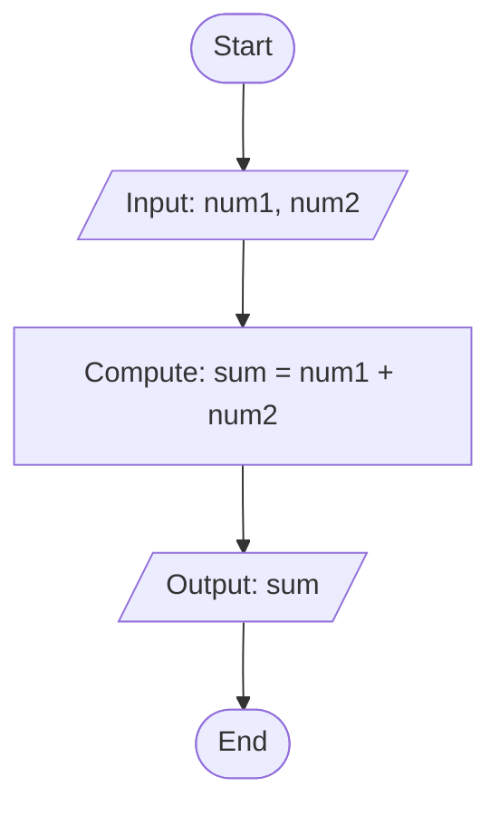

# COS 201 — Computer Programming I: Comprehensive Assignment Guide

> **Course Code**: COS 201  
> **Course Title**: Computer Programming I  
> **Target Programmes**: Computer Science (CSC), Cybersecurity (CYB), Information Systems (INS), Software Engineering (SEN), Industrial Chemistry (ICH)  
> **Development Environment**: JDK 21 / OpenJDK, Antigravity / Visual Studio Code, Git, GitHub Desktop  

---

## Table of Contents

1. [Introduction to Coursework](#1-introduction-to-coursework)
2. [Week 1 — Foundations of Programming & Problem Solving](#2-week-1--foundations-of-programming--problem-solving)
   - [What is a Computer Program?](#what-is-a-computer-program)
   - [Programming and Problem-Solving](#programming-and-problem-solving)
   - [Program Development Life Cycle (PDLC)](#program-development-life-cycle-pdlc)
   - [The Input-Processing-Output (IPO) Model](#the-input-processing-output-ipo-model)
   - [Algorithms, Pseudocode, Flowcharts & Source Code](#algorithms-pseudocode-flowcharts--source-code)
   - [Common Error Categories: Syntax, Runtime, and Logical Errors](#common-error-categories-syntax-runtime-and-logical-errors)
   - [Week 1 Written Activities (Paper Submission)](#week-1-written-activities-paper-submission)
   - [Week 1 Practical Exercise: FirstProgram.java](#week-1-practical-exercise-firstprogramjava)
3. [Week 2 — Development Environment & First Java Program](#3-week-2--development-environment--first-java-program)
   - [JDK, JVM, and Java Compiler Explained](#jdk-jvm-and-java-compiler-explained)
   - [Verifying Java Installation](#verifying-java-installation)
   - [Class Structure and Filename Conventions](#class-structure-and-filename-conventions)
   - [Output Methods: print() vs println()](#output-methods-print-vs-println)
   - [Git, GitHub, and Version Control Fundamentals](#git-github-and-version-control-fundamentals)
   - [Systematic Debugging Workflow](#systematic-debugging-workflow)
   - [Week 2 Practical Programs: HelloWorld.java & StudentProfile.java](#week-2-practical-programs-helloworldjava--studentprofilejava)
4. [Week 3 — Variables, Data Types, Expressions & Input/Output](#4-week-3--variables-data-types-expressions--inputoutput)
   - [Variables, Constants, and Identifiers](#variables-constants-and-identifiers)
   - [Java Data Types (Primitive vs Reference)](#java-data-types-primitive-vs-reference)
   - [Arithmetic Operators, Precedence & Integer Division Trap](#arithmetic-operators-precedence--integer-division-trap)
   - [Keyboard Input Handling with Scanner](#keyboard-input-handling-with-scanner)
   - [Formatted Output with printf()](#formatted-output-with-printf)
   - [Defensive Programming and Input Validation](#defensive-programming-and-input-validation)
   - [Week 3 Practical Programs](#week-3-practical-programs)
5. [Local Testing & Test Cases](#5-local-testing--test-cases)
6. [Submission Workflow & Final Checklist](#6-submission-workflow--final-checklist)

---

## 1. Introduction to Coursework

The COS 201 practical coursework establishes core software development competencies in Java. It guides university students through disciplined programming practices: breaking down human problems into logical algorithms, implementing solutions using structured Java code, defending against invalid user inputs, recording version history with Git, and submitting verifiable coursework through GitHub.

---

## 2. Week 1 — Foundations of Programming & Problem Solving

### What is a Computer Program?
A **computer program** is an ordered sequence of explicit instructions written in a programming language that instructs hardware components (CPU, memory, storage) to carry out a specific computing task or solve an identified problem.

### Programming and Problem-Solving
Programming is fundamentally an exercise in **structured problem-solving**. Before writing code in an editor:
1. Understand the problem thoroughly.
2. Identify known inputs and desired outputs.
3. Establish unambiguous procedural steps to transform the inputs into the outputs.

### Program Development Life Cycle (PDLC)
Professional software engineers follow systematic stages when building applications:
1. **Problem Analysis**: Define user requirements, inputs, outputs, and operational constraints.
2. **Algorithm Design**: Formulate logical step-by-step strategies using pseudocode and flowcharts.
3. **Coding / Implementation**: Translate algorithms into syntactically valid source code (e.g., Java).
4. **Compilation & Testing**: Compile code into bytecode, execute test suites, and detect faults.
5. **Debugging & Refinement**: Locate and fix syntax, runtime, or logical errors.
6. **Documentation & Maintenance**: Document design decisions, usage instructions, and update as requirements evolve.

### The Input-Processing-Output (IPO) Model
Every functional program operates on the **IPO model**:
- **Input**: Data received from keyboard, files, networks, or sensors.
- **Process**: Arithmetic operations, logical evaluations, data transformations, and decision paths.
- **Output**: Presenting transformed results to the console, storage, or external systems.

```
+---------------+      +-------------------+      +----------------+
|     INPUT     | ---> |    PROCESSING     | ---> |     OUTPUT     |
| (Raw Data)    |      | (Transformations) |      | (Results/Info) |
+---------------+      +-------------------+      +----------------+
```

### Algorithms, Pseudocode, Flowcharts & Source Code

| Technique | Definition | Purpose |
|---|---|---|
| **Algorithm** | A finite, well-defined sequence of instructions that accomplishes a task. | Conceptual problem roadmap independent of programming language. |
| **Pseudocode** | Informal, human-readable structured English outlining program flow without rigid syntax. | Bridges mental logic and actual programming language syntax. |
| **Flowchart** | Graphical diagram using standardized shapes (ovals, rectangles, diamonds) connected by directional arrows. | Visualizes execution pathways, loops, and branching logic. |
| **Source Code** | Strict, syntactically correct text written in a specific language (such as Java). | Interpretable and executable by machine compilers and runtimes. |

#### Example: Sum of Two Numbers

**Pseudocode:**
```text
BEGIN
    PROMPT "Enter first number"
    READ num1
    PROMPT "Enter second number"
    READ num2
    SET sum = num1 + num2
    DISPLAY "The sum is: " + sum
END
```

**Flowchart Representation:**


### Common Error Categories: Syntax, Runtime, and Logical Errors

1. **Syntax Errors**:
   - Occur when code violates Java grammar rules (e.g., missing semicolon `;`, mismatched curly braces `{}`, misspelled keywords like `statc`).
   - Caught at **compile time** by `javac`. Bytecode `.class` file is *not* generated until all syntax errors are resolved.

2. **Runtime Errors (Exceptions)**:
   - Code is syntactically valid and compiles cleanly, but crashes during execution when an illegal operation occurs (e.g., dividing by zero `5 / 0`, supplying letters when a number is expected `InputMismatchException`).
   - Mitigated through **defensive validation** (checking inputs before operating).

3. **Logical Errors**:
   - Program compiles and executes without crashing, but computes or displays the wrong output due to flawed developer reasoning (e.g., writing `sum = a - b` instead of `a + b`, or performing integer division `5 / 2 = 2` when `2.5` was intended).
   - Caught through rigorous test cases with known, pre-calculated expected results.

---

### Week 1 Written Activities (Paper Submission)

> [!IMPORTANT]
> The COS 201 lecture note explicitly states that the following activities are to be **written on paper and submitted by hand to the lecturer**. They are preserved here verbatim from the lecture note for reference:

#### Activity A — Identify the IPO Components
For each problem, write the input, process, and output:
1. Calculate the area of a rectangle with length 12 and width 5.
   - *Input*: Length (12), Width (5)
   - *Process*: Area = length × width (12 × 5 = 60)
   - *Output*: Area of the rectangle (60)
2. Calculate the average of four examination scores.
   - *Input*: Four scores ($s_1, s_2, s_3, s_4$)
   - *Process*: Total = $s_1 + s_2 + s_3 + s_4$; Average = Total / 4.0
   - *Output*: Average score
3. Determine whether a number is positive, negative, or zero.
   - *Input*: A number ($N$)
   - *Process*: If $N > 0$, positive; else if $N < 0$, negative; else zero
   - *Output*: Classification label ("Positive", "Negative", or "Zero")
4. Calculate the total price of six items costing ₦250 each.
   - *Input*: Quantity (6), Unit price (₦250)
   - *Process*: Total price = 6 × 250 = ₦1,500
   - *Output*: Total price (₦1,500)
5. Calculate the number of failed login attempts recorded in a sample security log.
   - *Input*: Stream/list of security log event records
   - *Process*: Iterate through logs; increment counter for each event where status equals "FAILED"
   - *Output*: Total count of failed authentication attempts

#### Activity B — Write Algorithms
1. Write an algorithm for each task.
2. Accept two numbers and display their sum.
3. Calculate the area of a circle using $A = \pi r^2$.
4. Accept a student's score and determine whether the student passed, using 50 as the pass mark.
5. Accept three numbers and display the largest.
6. Calculate the total cost of items purchased, given quantity and unit price.

#### Activity C — Pseudocode and Flowcharts
Choose any two problems from Activity B. For each selected problem:
- Write the algorithm in numbered steps.
- Convert the algorithm into pseudocode.
- Draw a flowchart using standard flowcharting symbols (terminal, input/output parallelogram, process rectangle, decision diamond).

---

### Week 1 Practical Exercise: FirstProgram.java

- **File**: `week01/FirstProgram.java`
- **Purpose**: Displays course metadata, programme of study placeholder, three discipline-specific rationales for learning programming (computational problem solving, automation, and secure software development), and one personal learning goal.
- **Compilation & Execution**:
  ```bash
  cd week01
  javac FirstProgram.java
  java FirstProgram
  ```

---

## 3. Week 2 — Development Environment & First Java Program

### JDK, JVM, and Java Compiler Explained

Java applications follow the **"Write Once, Run Anywhere" (WORA)** paradigm through bytecode abstraction:

```
[Developer]
    |
    v
+-------------------+
|  HelloWorld.java  |  (Human-readable source code)
+-------------------+
    |
    |  javac (Java Compiler)
    v
+-------------------+
| HelloWorld.class  |  (Platform-independent bytecode)
+-------------------+
    |
    |  java (JVM - Java Virtual Machine)
    v
+-------------------+
| Native Execution  |  (Windows, Linux, macOS)
+-------------------+
```

- **JDK (Java Development Kit)**: Complete toolkit containing the compiler (`javac`), runtime environment, archiver (`jar`), and debugging utilities required to build software.
- **Compiler (`javac`)**: Translates human-readable `.java` text files into platform-agnostic bytecode instructions saved in `.class` files.
- **JVM (Java Virtual Machine)**: Platform-specific execution engine that loads `.class` bytecode and interprets/compiles it into native machine code for the host CPU.

### Verifying Java Installation
To verify that Java is installed and accessible from your terminal:
```bash
java -version
javac -version
```
Both commands must report version numbers (e.g., `openjdk version "21.0.x"` and `javac 21.0.x`). If a "command not found" error is displayed, the JDK's `bin` folder must be added to your system's `PATH` environment variable.

### Class Structure and Filename Conventions
In Java:
1. Every piece of executable code resides within a **class**.
2. If a class is declared `public`, the file name must **exactly match** the class name, including case:
   - Class: `public class HelloWorld { ... }`
   - File: `HelloWorld.java`
3. Program execution begins at the canonical entry point:
   ```java
   public static void main(String[] args)
   ```

### Output Methods: print() vs println()
- `System.out.println("text")`: Prints the supplied text and appends a newline character, moving the cursor to the start of the next line.
- `System.out.print("text")`: Prints the text and leaves the cursor immediately after the last character, allowing subsequent outputs to appear on the same line.

### Git, GitHub, and Version Control Fundamentals
- **Working Tree**: Local project files on your hard drive where edits occur.
- **Staging / Index**: Selected modifications marked to be captured in the next snapshot.
- **Commit (`git commit`)**: Permanent local snapshot capturing changes with an explanatory message.
- **Remote Push (`git push`)**: Transmitting local commits across the network to GitHub.

> [!NOTE]
> Saving a file in an editor only updates your local disk. It is **not** committed to version history until you run `git commit`, and **not** visible to your instructor until you run `git push origin main`.

### Systematic Debugging Workflow
When encountering errors:
1. **Read the Error Message**: Identify the offending file, line number, and error token.
2. **Inspect Context**: Check the indicated line and the preceding line (common culprit: missing `;`).
3. **Isolate One Fix**: Make a single targeted correction.
4. **Recompile**: Run `javac` to verify resolution before making further edits.

### Week 2 Practical Programs

1. **`week02/HelloWorld.java`**:
   - Prints course title, programme, week number, topic, and learning goal.
   - Run via:
     ```bash
     cd week02
     javac HelloWorld.java
     java HelloWorld
     ```

2. **`week02/StudentProfile.java`**:
   - Dynamically captures student name, programme, and course code from console input using `Scanner`.
   - Formats input into a student profile card.
   - Run via:
     ```bash
     cd week02
     javac StudentProfile.java
     java StudentProfile
     ```

---

## 4. Week 3 — Variables, Data Types, Expressions & Input/Output

### Variables, Constants, and Identifiers
- **Variable**: Named memory location holding a typed value that may change during program execution.
- **Constant (`final`)**: Variable whose value is initialized once and cannot be reassigned:
  ```java
  final double PASS_MARK = 50.0;
  ```
- **Identifier Rules**:
  - Must begin with a letter, underscore (`_`), or dollar sign (`$`).
  - Cannot contain spaces or match Java reserved keywords (`class`, `int`, `public`).
  - Follow camelCase naming conventions (`firstNumber`, `totalScore`).

### Java Data Types (Primitive vs Reference)

#### 8 Primitive Types
- Integers: `byte` (8-bit), `short` (16-bit), `int` (32-bit, default), `long` (64-bit).
- Decimals: `float` (32-bit single precision), `double` (64-bit double precision, default).
- Character: `char` (16-bit Unicode character, e.g., `'A'`).
- Boolean: `boolean` (`true` or `false`).

#### Reference Types
- `String`: An object class representing sequences of characters (`"Computer Programming"`).

### Arithmetic Operators, Precedence & Integer Division Trap

| Operator | Meaning | Example |
|---|---|---|
| `+` | Addition | `a + b` |
| `-` | Subtraction | `a - b` |
| `*` | Multiplication | `a * b` |
| `/` | Division | `a / b` |
| `%` | Modulus (Remainder) | `a % b` |

#### The Integer Division Trap
When both operands are integers, Java executes **integer division**, discarding any fractional remainder:
```java
int a = 5;
int b = 2;
double result = a / b; // Computes 5 / 2 = 2, then converts 2 to 2.0 (Incorrect!)
```
**Correct Solution (Explicit Cast or Floating Constant):**
```java
double result = (double) a / b; // Computes 5.0 / 2 = 2.5
// or
double average = total / 3.0;   // Floating constant forces floating division
```

### Keyboard Input Handling with Scanner
The `java.util.Scanner` class reads keyboard input:
```java
Scanner input = new Scanner(System.in);
String text = input.nextLine();   // Reads entire line
int count = input.nextInt();      // Reads integer token
double value = input.nextDouble();// Reads double token
input.close();                    // Releases system resource
```

### Formatted Output with printf()
The `System.out.printf()` method supports C-style format specifiers:
- `%s`: Formats text strings.
- `%d`: Formats decimal integers.
- `%.2f`: Formats floating-point numbers rounded to 2 decimal places.
- `%n`: Inserts a platform-independent newline.

Example:
```java
System.out.printf("Average Score: %.2f%n", 84.66667); // Output: Average Score: 84.67
```

### Defensive Programming and Input Validation
Programs operating in security-critical environments must never assume user input is valid:
1. **Division by Zero Protection**: Check that the denominator is non-zero before invoking `/`.
2. **Range Validation**: Reject academic scores $< 0$ or $> 100$.
3. **Domain Constraints**: Reject negative prices or quantities $\le 0$.

### Week 3 Practical Programs

1. **`week03/SimpleCalculator.java`**:
   - Takes two numbers and calculates sum, difference, product, and quotient.
   - Evaluates `if (secondNumber != 0.0)` to safely avoid `ArithmeticException`.

2. **`week03/AverageCalculator.java`**:
   - Accepts student name and 3 course scores.
   - Uses `while` validation loops to guarantee each score is between $0.0$ and $100.0$.
   - Computes total and average using `3.0`.

3. **`week03/ItemCost.java`**:
   - Accepts item name, integer quantity, and double unit price.
   - Validates that quantity $\ge 1$ and unit price $\ge 0.0$.
   - Computes total cost and formats output.

---

## 5. Local Testing & Test Cases

The following test cases demonstrate correct execution across normal, boundary, and error inputs:

### SimpleCalculator Test Matrix
| Case | Input 1 | Input 2 | Sum | Difference | Product | Quotient | Status |
|---|---|---|---|---|---|---|---|
| Normal | `20.00` | `4.00` | `24.00` | `16.00` | `80.00` | `5.00` | Passed |
| Decimals | `15.50` | `2.50` | `18.00` | `13.00` | `38.75` | `6.20` | Passed |
| Zero Divisor | `50.00` | `0.00` | `50.00` | `50.00` | `0.00` | Division is undefined for a zero divisor | Handled Safely |

### AverageCalculator Test Matrix
| Case | Name | Score 1 | Score 2 | Score 3 | Total | Average | Status |
|---|---|---|---|---|---|---|---|
| Standard | `Amina Bello` | `70` | `80` | `90` | `240.00` | `80.00` | Passed |
| Fractional | `David Akintola` | `75.5` | `82.0` | `88.5` | `246.00` | `82.00` | Passed |
| Out-of-Range | Student | `-5` (rejected) $\to$ `50` | `120` (rejected) $\to$ `70` | `80` | `200.00` | `66.67` | Re-prompted successfully |

### ItemCost Test Matrix
| Case | Item | Quantity | Unit Price | Total Cost | Status |
|---|---|---|---|---|---|
| Standard | `Notebook` | `3` | `1500.00` | `4500.00` | Passed |
| Zero / Negative Qty | `Pen` | `0` (rejected) $\to$ `5` | `200.00` | `1000.00` | Re-prompted successfully |
| Negative Price | `Flash Drive` | `2` | `-150` (rejected) $\to$ `3500.00` | `7000.00` | Re-prompted successfully |

---

## 6. Submission Workflow & Final Checklist

### Lecturer Google Form Submission URL:
**Form Link**: [COS 201 Assignment Submission Form](https://docs.google.com/forms/d/e/1FAIpQLScfFS-TTZZdgAZ9qPEFp8gNJpHCu0cYudvHJizNCbKOACAb1A/viewform?usp=header)

### Recommended Git Commit Sequence:
If committing in stages to reflect weekly progress:
1. **Week 1**: `Complete Week 1 Java practical`
2. **Week 2**: `Complete Week 2 Java practical`
3. **Week 3**: `Complete Week 3 practicals and update documentation`

### Final Pre-Submission Checklist:
- [ ] JDK 21 installed and confirmed with `javac -version`.
- [ ] All `.java` source files compile cleanly without errors.
- [ ] All editable placeholders in `README.md` and Java files customized.
- [ ] `.gitignore` is present so `.class` files are not tracked.
- [ ] Commits pushed to `origin main` on GitHub.
- [ ] Repository confirmed public or lecturer granted access if private.
- [ ] Real repository URL pasted into the lecturer's Google Form.
- [ ] Week 1 written activities (IPO, algorithms, flowcharts) written on paper for physical submission.
